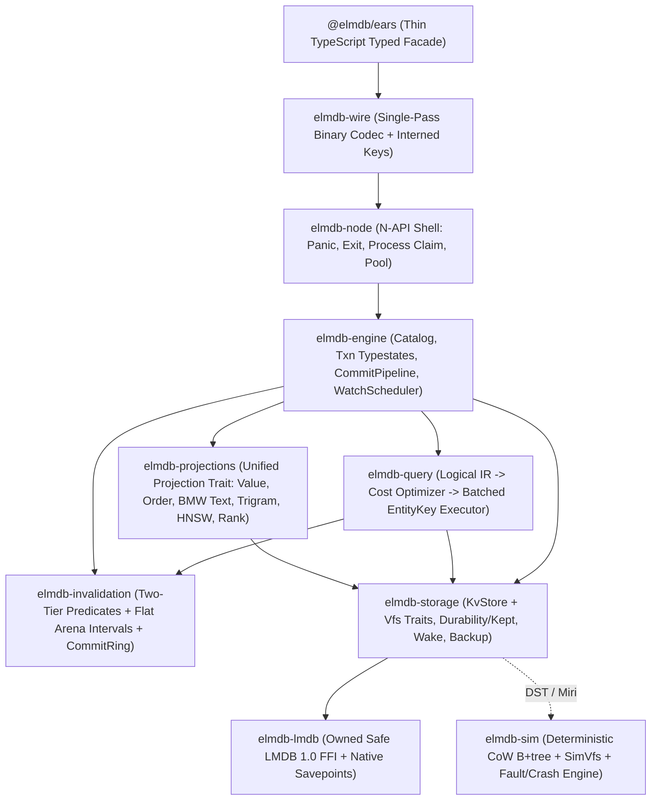
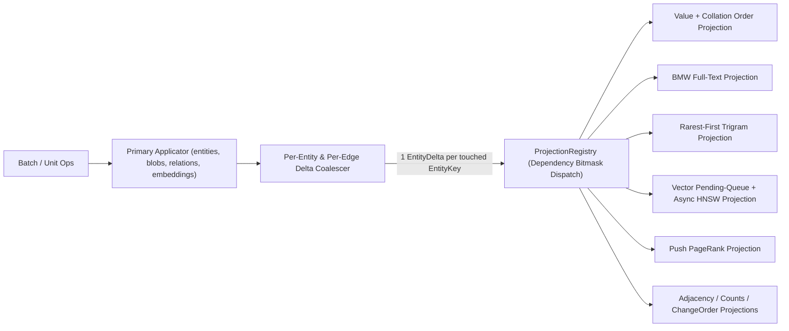
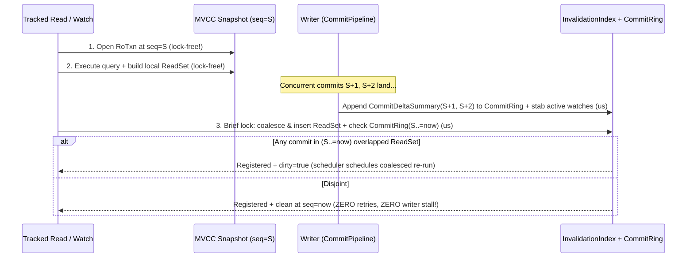
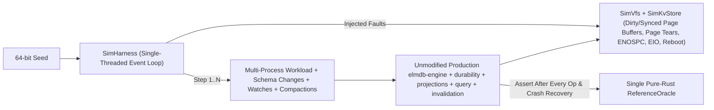

# `elmdb` v2 — Clean-Room Architecture & Algorithm Design

> **Design Stance:** Zero backward compatibility with v1's on-disk format, wire protocol, Rust internals, or TypeScript APIs. Every v1 mechanism is treated strictly as empirical evidence of requirements, hardware constraints, and real-world failure modes.
>
> **Status:** Locked architectural specification (incorporating all finalized design decisions and implementation guardrails). Ready for Phase 0 execution on the long-lived feature branch `feat/elmdb-v2`.

---

## 1. Empirical Post-Mortem of v1

An exhaustive audit of v1 (~54k LOC across `crates/elmdb`, `crates/elmdb-node`, `packages/ears`, and `docs/architecture/*`) reveals an unusually clear split between **crown jewels we must preserve/elevate** and **seven structural root causes** that generated most of v1's accidental complexity.

### 1.1 Crown Jewels to Preserve & Elevate
1. **Power-loss-safe group commit over `MDB_NOSYNC`** (`store/{kept,record,restore,reach,boot,commits}.rs`): Pinning the last durable commit before any write transaction begins, dual-slot 4 KiB sidecar records with root-page SHA-256 + OS boot IDs, fail-stop `State::Failed` poisoning (`fsyncgate` correctness), freelist-retention backpressure (`max(16 MiB, file / 4)`), and seek-based pre-map B-tree reachability (`reach.rs`) to defeat `SIGBUS` on torn files.
2. **History-independent dyadic posting blocks** (`engine/text/postings.rs`, `engine/places.rs`): Inline `<= 256` places transitioning to power-of-two aligned `[start, start + 2^level)` blocks. Canonical bytes depend *only* on the set of places — simultaneously giving O(1)-block incremental writes and bit-exact `check()` equivalence.
3. **Online zero-stats adaptive query execution** (`engine/reads.rs`): `Spread`-adaptive Leapfrog Triejoin (`u128` cross-multiplied spacing switching at `> 2x`), competitive doubling probes (`16, 32, 64…`) for range vs. filter and index-order vs. top-K sort, strictly isolated from read-set tracking (`Read::probe*`).
4. **Incremental push PageRank with provable L1 online error bounds** (`engine/ranks.rs`): Exact residual invariant `r = b + α P^T x̂ - x̂`, coarse quantized score-order cells, optimistic off-lock draining, and watch-stable score rounding.
5. **Truncated ICU collation sort keys with version stamps** (`engine/order.rs`): Prefix-truncated sort keys + 32-byte collator stamp preventing silent cross-version index corruption.
6. **Hard-won OS/Node/V8 survival machinery** (`elmdb-node/src/{panics,exit,process}.rs`, `store/{writers,wake,backup}.rs`): Kernel-owned single-binary LMDB claim (abstract Linux socket / macOS Mach port / Windows pinned named event), exhaustive `catch_unwind` + handle poisoning, `BufferSlice::copy_from` + `env.spawn` avoiding Node 24/napi-rs bugs, sandbox-safe FIFO/auto-reset-event cross-process wake, and macOS POSIX-semaphore dead-writer recovery.
7. **Schema-parametric TypeScript ergonomics & verification culture** (`packages/ears/src/{typed,query}.ts`, `testing.md`): Zero-native browser-safe `@elmdb/ears` root, `Same<A, B>` structural port checks, TS language-service completion tests, `cargo-mutants` on PR diffs, Shuttle/Loom, Miri, ASan/UBSan, and `gungraun` instruction gating.

### 1.2 The Seven Structural Root Causes in v1

| # | Root Cause in v1 | Downstream Damage |
|---|---|---|
| **R1** | **String-keyed EAV in one 46-prefix B-tree** (`p/v <str-id> <str-field>`, `u64 as f64` tuple keys) | Repeating 20–128 B string IDs + string field/type/index names in every key slashes B+tree fanout, slams into LMDB's 511 B key ceiling (10 value-index prefixes, `order_room` contortions), forces `rmpv::Value` DOM allocation even for 3-field fixed engine structs (`p/i`, `p/s`, `d/c`), loses precision past 2^53, copies `&'txn [u8]` to `Vec<u8>` on every `get()`, and makes index drops O(N) key-by-key deletes. |
| **R2** | **No `Projection` abstraction; per-field (not per-entity) write fan-out** | Adding an index touches 15–18 hardcoded sites. `drop_index_data` duplicates `clear()` and diverges on `p/q`; `index_status()` omits text/trigram/vector; `stats_of()` ignores non-value indexes and loads primary data via `r.scan()`. `Op::Create`/`put_fields` re-tokenize text/trigram/vector once per *field* instead of once per *entity*. Synchronous index drops inside `set_schema` stall all readers and writers. |
| **R3** | **5,793-line direct-AST recursive-closure query interpreter** (`reads.rs`) | No Logical → Physical plan boundary. `MAX_STEPS = 256` OS stack cap; fragile `Cell` side-channels (`asked`, `sought`, `whole`, `backward_hop`); missing pushdowns (`count` after `where`, `limit`/`filter` into `near`/`hybrid`/`containing`/`distinct`/`last`/`sum`/`groupBy(counts)`); uncached ICU collator built per query; `Instant::now()` called 2× per entity in `EXPLAIN`. |
| **R4** | **Heap-copying KV undo log + `transmute::<RwTxn<'a>, RwTxn<'static>>`** (`unit.rs`) | Forced by `heed`'s stack-bound nested `RwTxn`. Every savepoint write clones keys 2–3×, triggers extra `db.get` reads, fails to roll back `pending_tracks`, and can poison the unit if rollback hits `MAP_FULL`. Soundness relies on struct field drop order. |
| **R5** | **Global `tracks.lock()` held across slow queries + uncoalesced treap + dual watch schedulers** | On attempt #3, tracked reads run the *entire query* while holding `tracks.lock()`, stalling every writer in the database. Seeking cursors insert thousands of uncoalesced ranges (5 heap allocs/range, O(log N) clones on split/merge). Rust's `watch.rs` goes unused by Node while TS maintains an 871-line scheduler fighting async TSFN watermarks (`syncBuilder()`, sequence-ahead `defer()` loops). |
| **R6** | **Chatty, multi-pass FFI + duplicated TS/Rust logic** | Every write does: JS `msgpackr.pack` → N-API → `validate()` pass → `rmp_serde` into `rmpv::Value` → re-encode msgpack → full `ChangeSet` serialized, copied, unpacked in JS, and **discarded**. Chained `WriteBuilder` methods don't batch and `write(id)` fires a speculative `exists(id)` N-API read first. Both Rust (`may_hold_proto`) and JS (`spellsProto`) linearly scan every response byte. ID parsing, schema caching, `beforeCommit`, error codes (61 vs 24), and clocks are split across languages. |
| **R7** | **LMDB 0.9 private-struct coupling + 11 lock domains + unmodelled storage/durability** | Hand-typed LMDB 0.9 offsets break on LMDB 1.0; `hannoy` locks v1 onto stale `heed 0.23`. 13 core concurrency files are excluded from Shuttle/Loom (`ReentrantMutex`/`RecursiveRwLock`), and `synced_model.rs` checks an abstract 6-page model disconnected from production `kept.rs`/`restore.rs`. |

---

## 2. System Topology & Deep Module Boundaries

`elmdb` v2 is structured as **six deep, orthogonal layers** with strict unidirectional dependencies and compile-time-enforced boundaries.



### Single Choke Points (One Authoritative Owner Per Invariant)

| Invariant | Single Owner | Compile-Time / Runtime Guarantee |
|---|---|---|
| **Storage & MVCC** | `KvStore` trait (`elmdb-storage`) | Zero-copy `&'txn [u8]` tied to `RoTxn<'env>` / `RwTxn<'env>`; `commit(self)` affine consumption; native LIFO `SavepointGuard`. |
| **Durability & Pin** | `DurabilityGate::commit` | The *only* function able to invoke `RwTxn::commit`; verifies pin, syncs, hashes roots, poisons on fsync failure. |
| **Schema & Catalog** | `CompiledSchema` (`Arc`) | Parsed & validated once at boundary; assigns monotonic never-reused `TypeId(u16)`, `FieldId(u16)`, `RelKindId(u16)`, `RoleId(u16)`, `IndexId(u32)` mapped onto a bounded pool of reusable `SubDbSlot(u16)`s; caches `icu_collator` once. |
| **Primary-to-Derived** | `CommitPipeline` → `ProjectionRegistry` | Coalesces mutations into one `EntityDelta` per entity & `EdgeDelta` per edge; flushes to `ProjectionRegistry` before `beforeCommit` hooks (bounded cascade, max 8 rounds). |
| **Query Semantics** | `LogicalPlan` → `PhysicalOp` | Upfront binding to typed catalog IDs; single place for pushdown rewrites, cost probes, and `EXPLAIN`. |
| **Live Invalidation** | `InvalidationEngine` + `WatchScheduler` | Lock-free MVCC read + in-process `CommitRing` + persisted 4,096-commit cross-process summary log; single sans-I/O Rust scheduler owns watermarks, gaps, `soon`, and `caughtUp`. |
| **Wire & Errors** | `elmdb-wire` + single `ErrorCode` enum | One binary format, one `ErrorCode` taxonomy generated directly into TS, zero duplicate codecs or code renames. |

---

## 3. Substrate, Storage Layout & Crash/Concurrency Model

### 3.1 Storage Engine Decision: Owned LMDB 1.0 Wrapper (`elmdb-lmdb`) + `KvStore`/`Vfs` Seam for DST

**Decision:** Keep **LMDB** as the production storage kernel, but **replace `heed 0.23` and `hannoy` with a thin, owned safe Rust wrapper (~800 LOC) directly over upstream LMDB 1.0** (`elmdb-lmdb`), parameterized behind zero-cost generic `KvStore` + `Vfs` traits so production compiles monomorphically against LMDB 1.0 while **Deterministic Simulation Testing (DST)** runs the exact same production engine over a pure-Rust `SimKvStore` + `SimVfs`.

- **Core invariant upheld:** Zero-copy, lock-free multi-process MVCC reads with linearizable crash-only commits, native savepoints, and 100% deterministic in-process simulation of production durability and recovery code.
- **Algorithmic complexity & memory/IO profile:**
  - Point lookup: O(log_B N) with B ≈ 100–250 (4–16 KiB pages, integer keys) — **~80–150 ns** warm in OS page cache, **0 heap allocations** (`&'txn [u8]` borrow).
  - Native nested savepoint open/rollback/release: **O(dirty pages in savepoint)** in LMDB C memory, **0 extra `db.get` reads, 0 key/value Vec clones**.
  - Sub-DB index drop (`mdb_drop(txn, dbi, 0)`): **O(1)** metadata truncate (returns pages to freelist without per-key deletes and **never calls `mdb_dbi_close()`**, preventing `MDB_DBS_FULL` leaks in long-lived Electron processes!).
  - Virtual address space on 64-bit Unix: **16 GiB sparse virtual reservation** at open (0 physical RAM, 0 disk bytes allocated until written) — eliminates `MapFull` abort-and-retry and `env.resize()` tail-latency stalls for 99.99% of databases. On Windows (eager file backing), retain `64 MiB` doubling with `MapGate`.
  - Concurrency, durability & security envelope: single-writer / many-reader LMDB multi-process model, **grouped durability** default, and **no built-in at-rest encryption** (rely on OS FileVault/BitLocker, keeping LMDB zero-copy borrows intact).
  - `max_dbs = 512` (up from 8), `max_readers = 512` (up from 126). **DBI Slot Exhaustion Invariant:** Each projection uses **1 single LMDB sub-DB** (with a 1-byte internal table-tag prefix) drawn from a bounded pool of reusable `SubDbSlot(u16)` names (`p_000`..`p_N`). Rebuilds and HNSW compactions build into a staging slot, flip active slot in `meta`, and O(1)-truncate (`mdb_drop(..., 0)`) and recycle the retired slot (LMDB MVCC keeps old snapshots readable for active `RoTxn`s) — bounding open `MDB_dbi` handles strictly by `O(concurrent_live_indexes)` forever, even across 100,000 compactions or pack reloads.

- **Serious alternatives rejected:**
  1. **Custom pure-Rust CoW B+tree (e.g., `redb`-style or bespoke page engine):** Would give native page checksums, zero C FFI, and no 511 B key limit — *rejected* because `redb` (and every pure-Rust embedded B-tree today) does **not** support true multi-process concurrent readers + writers (`apack` requires concurrent Electron host + CLI/agent subprocesses). Building multi-process lock-free CoW MVCC + shared-memory reader tables + cross-process cache coherence from scratch is a multi-year kernel project whose edge-case bugs dwarf LMDB's quirks, and using `mmap` would reintroduce `SIGBUS`/resize anyway.
  2. **SQLite (WAL mode) or LSM-tree (`RocksDB` / `fjall`):** LSM-trees forbid multi-process read+write and suffer read amplification + background compaction CPU spikes unsuitable for sub-50 µs synchronous JS reads in Electron. SQLite supports multi-process WAL and dynamic growth, *but* copies pages through a user-space buffer pool (no zero-copy borrows for roaring/HNSW/posting blocks), imposes SQL/bytecode overhead unless bypassing its public API, and suffers WAL checkpoint tail spikes under long-lived live-query readers.

- **Sharpest risk & architectural neutralization:**
  - *Risk:* Owning raw LMDB 1.0 FFI concentrates `unsafe` (cursor/txn lifetime aliasing, `MDB_meta` struct offsets for `reach.rs` / `kept.rs`).
  - *Neutralization:*
    1. All `unsafe` lives inside `elmdb-lmdb` (~800 LOC). Borrowed slices carry lifetime `'txn`; `WriteTxn` holds an `Arc<EnvInner>` + `NonNull<MDB_txn>` with LIFO `Vec<NonNull<MDB_txn>>` savepoint stack (zero `transmute` to `'static`!).
    2. Never hand-type LMDB C struct offsets: `build.rs` compiles a tiny C probe against the exact vendored `lmdb.h` / `mdb.c` headers to emit `META_MAGIC_OFFSET`, `META_PSIZE_OFFSET`, `META_MAIN_ROOT_OFFSET`, etc., verified by compile-time assertions.
    3. Differential fuzzing runs identical randomized transaction sequences against `LmdbBackend` and `SimKvBackend` under ASan/UBSan to prove bit-exact behavioral equivalence.

### 3.2 Durability, Crash Recovery & Lock Hierarchy Collapse

v1 accumulated **11 lock domains**, 4 sleep-polling loops, and circular `store` ↔ `engine` dependencies. v2 collapses concurrency to **4 strictly ordered lock domains** (statically checked by `cargo xtask check-locks` + modelled under Shuttle/DST):

```
Lock Order (strict total order — never inverted):
  L1: SchemaEpochLock (RwLock — read-mostly; NEVER held during index drops or builds)
  L2: MapGate (RwLock — only write-locked on Windows growth or Unix >16 GiB overflow; non-recursive!)
  L3: WriterLock (Mutex + OS lock — serializes LMDB write transactions + DurabilityGate)
  L4: Metadata / Invalidation / Scheduler Mutexes (short O(µs) critical sections; NEVER hold across I/O or query execution!)
```

- **Key simplifications over v1:**
  - **Eliminate `ReentrantMutex` and `RecursiveRwLock`:** Making all 4 locks plain `Mutex`/`RwLock` makes 100% of production concurrency code directly compatible with Shuttle/Loom/DST (closing v1's 13-file `UNMODELLED` hole!).
  - **Eliminate all 4 `sleep(1ms)` polling loops:** Replace `Arc::try_unwrap` polling on close with an explicit `Condvar`-backed active-handle counter; replace `sync::lock_before` polling with `Condvar::wait_timeout`; replace `grow_beside_units` polling with an explicit `UnitGate` condvar.
  - **Async cross-process wake:** `CommitPipeline` posts a single `AtomicBool` / `Condvar` signal to a lightweight wake-notifier thread instead of running `stat()` + per-peer FIFO `open`/`write`/`close` syscalls while holding `WriterLock`!
  - **Zero `store` ↔ `engine` circularity:** `elmdb-storage` knows nothing about `EdgeMirror`, `Touched`, `changed::stamp`, or ranks. It only provides `KvStore` + `DurabilityGate` + `WakeChannel` + `Backup`.
  - **Retain v1's proven durability protocol, run through `Vfs`:** Pin-before-write, dual-slot `synced` record with `roots_checksum` + `BootId` (fixing Windows boot ID to use `GetTickCount64` boot-epoch anchor + machine-local temp lockfile rather than `HKCU` volatile registry so user logoff doesn't fake a reboot!), fail-stop `State::Failed` poisoning, freelist retention bound (`max(16 MiB, file / 4)`), and seek-based pre-map `reach()` SIGBUS defense.
  - **Atomic `dump`:** Stage dump files to a hidden temp file + fsync + atomic rename (closing v1's visible-partial-dump gap).

---

## 4. Data Model, Catalog Interning, Packed Entities & Schema Evolution

### 4.1 Integer Catalog & Packed-Row Storage Layout

**Decision:** Promote dense, **strictly monotonic, never-reused** integers (`EntityKey(u64)`, `RelKey(u64)`, `IndexId(u32)` — eliminating ABA bugs across HNSW nodes, tombstones, inverse refs, and `InvalidationIndex` by construction) plus catalog IDs (`TypeId(u16)`, `FieldId(u16)`, `RelKindId(u16)`, `RoleId(u16)`) to the **sole internal currency** across storage, indexes, edges, query execution, and invalidation. Replace v1's EAV (`p/v <id> <field>`) with **Hybrid Packed-Row + 4 KiB Out-of-Line Blob storage** across dedicated LMDB sub-DBs.

#### Primary Sub-DBs (Sole Ground Truth — Everything Else Is Disposable)

| Sub-DB | LMDB Flags | Key Layout | Value Layout | Role |
|---|---|---|---|---|
| `meta` | default | Fixed 1–2 B tag + optional ID | Canonical binary | Format v2, `CompiledSchema` + catalog counters + `SubDbSlot` pool, `CommitSeq`, `epoch`, `checkpoints`, `destroyed_floor` |
| `ext_id` | default | `UTF-8 external_id` (<= 256 B) | `EntityKey(u64)` (8 B LE) | External ID → internal key map (enforces global ID uniqueness in O(log N); 256 B ceiling accommodates path/slug IDs with zero overhead on short IDs) |
| `entities` | `MDB_INTEGERKEY` | `EntityKey(u64)` (8 B native) | `PackedRow` (whole-row zstd if `>= 256 B`) | All entity metadata + inline fields (`<= 4 KiB` each) |
| `blobs` | default | `EntityKey(8 B BE) \|\| FieldId(2 B BE)` (10 B) | `0x00 \|\| raw` or `0x01 \|\| zstd(<= 64 MiB)` | Out-of-line large field values (`> 4 KiB`) |
| `relations` | `MDB_INTEGERKEY` | `RelKey(u64)` (8 B native) | `PackedEdge` (`kind: u16, src: u64, dst: u64, weight: f64, flags: u16, info...`) | All primary edges; `info > 4 KiB` spills to `rel_blobs` |
| `embeddings` | default | `IndexId(4 B BE) \|\| EntityKey(8 B BE) \|\| chunk(4 B BE)` (16 B) | `model_hash(8 B) \|\| chunk_hash(32 B) \|\| prec(1 B) \|\| vec_bytes` | Content-addressed primary embeddings |
| `sequences` | default | `seq_tag(1 B) \|\| TypeId(2 B) \|\| opt_key` | `u64` (8 B LE) | Short codes, labels, strictly monotonic entity/rel key allocators |
| `commit_log` | default | `0x01 \|\| CommitSeq(8 B BE)` (summary) / `0x02 \|\| CommitSeq(8 B BE) \|\| EntityKey(8 B BE)` (tombstone) | Compact `CrossProcCommitSummary` (`schema_epoch`, `touched_types`, `touched_rel_kinds`, `<=64` `touched_entities`) or `TypeId \|\| ext_id` | Bounded ring (last 4,096 commits; meta, excluded from dump/rebuild) powering `changedSince` tombstones AND selective cross-process watch invalidation |

#### `PackedRow` Binary Layout (Zero-Copy Readable from `&'txn [u8]`)

```text
Offset  Size    Field
0       2       type_id: u16
2       2       flags: u16 (bit0=trashed, bit1=row_zstd, bit2=has_blobs, bit3=has_extra_fields)
4       2       inline_field_count: u16
6       2       ext_id_len: u16
8       8       updated_seq: u64
16      8       created_at_ms: i64
24      8       updated_at_ms: i64
32      8       trashed_at_ms: i64 (0 when live)
40      ext_len external_id: [u8; ext_id_len]
...     payload (raw or zstd-decompressed into thread-local scratch arena):
          [FieldDir; inline_field_count]  // sorted by field_id: (field_id: u16, tag: u8, flags: u8, offset: u32) — 8 B/entry
          [ExtraFields?]                  // only if additionalFields == allow and undeclared keys exist
          [InlineValues...]               // canonical binary encoded values (typed, zero-copy)
```

- **Core invariant upheld:** One B-tree lookup reads an entire entity; any individual field is located via O(log F) binary search in `FieldDir` returning a zero-copy `ValueRef<'txn>` without decoding sibling fields; small writes never rewrite > 4 KiB blobs; LMDB leaf pages hold 10–50× more keys/entries than v1's EAV string-keyed layout.
- **Canonical Typed Value Representation (`CanonicalValue` / `ValueRef<'txn>`):**
  - Replaces `rmpv::Value` completely. Every value is encoded in a strict canonical binary format:
    - Exact primitives: `Null`, `Bool`, `Int(i64)` (transparent JS `number` round-tripping for `|n| <= 2^53 - 1`, plus optional `int64`/`bigint` schema field type), `Float(f64)` (finite only), `Timestamp(i64 ms, u32 ns)`, `EntityRef(EntityKey(u64))`, `DanglingRef(&'txn str)`, `String(&'txn str)` (valid UTF-8), `Bytes(&'txn [u8])`, `Array`, `Object` (**keys strictly sorted, deduplicated at parse boundary — O(log N) lookup, O(N) deep equality**, eliminating v1's O(N^2) `rmpv::Value::Map` equality/merge!).
  - **Unified Numeric Index Key Invariant:** `Int(i64)` and `Float(f64)` share **one single numeric type tag** in LMDB index keys using canonical total numeric ordering (IEEE-754 sortable `f64` prefix + exact low-bit tie-breaker suffix for `|i| > 2^53`, with `Int(5) == Float(5.0)` encoding to the exact same key bytes) — guaranteeing ints and floats never split into separate index buckets on equality or range queries.
  - **`EntityRef(EntityKey(u64))` + `DanglingRef(String)` Referential Integrity Invariant (Zero Un-Decodable Keys):**
    - Declared `ref` / `list<ref>` fields store compact 8-byte `EntityRef(EntityKey(u64))` whenever the target exists, shrinking `ref` lists by 4–16× on disk, and maintain a lightweight inverse-ref projection `ref_in: (target_key: 8B BE, referrer_key: 8B BE, field_id: 2B BE) -> ()`.
    - Each `ref` field declares an explicit `onDelete` policy enforced atomically via `ref_in` on `destroy(target)`:
      - **`"restrict"` (default):** Refuses `destroy` with `REFERENCED` (naming the referencing entity & field) — true referential integrity by construction!
      - **`"setNull"` (opt-in on nullable/optional fields):** Atomically clears/nulls the field on referrers in the same commit.
      - **`"allowDangling"` (opt-in for soft/historical foreign keys):** Atomically rewrites `EntityRef(key)` → `DanglingRef(target_ext_id)` via `ref_in` before removing `target`, so the external ID string is **never lost** even 100,000 commits after `destroy`, and `check()` reports `DanglingRef` in O(1)! Unchecked imports with forward refs also store `DanglingRef(ext_id)` until resolved.
    - External IDs use human-readable `<Type>-<suffix>` at creation (or caller-supplied custom IDs) and are **immutable on `renameType` by default** — making `renameType` a true O(1) metadata update that preserves external URLs and `media://<entityId>/` filesystem paths (an optional explicit `rewriteIds` migration flag can rewrite prefixes only when requested, and even then edges and `ref` fields hold `EntityKey(u64)` and are untouched, eliminating v1's `VALUE_TOO_LARGE` rename failure mode!).
    - **Wire resolution caching:** During `elmdb-wire` result encoding, a per-response scratch map `FxHashMap<EntityKey, u16>` caches `EntityKey -> response_string_dict_id`, so 100 rows referencing the same parent perform **1 lookup** and emit the parent's `ext_id` string **once** in the wire header!
- **Algorithmic complexity & memory/IO profile:**
  - Read whole row: **1 `MDB_INTEGERKEY` lookup** (vs. `F + 1` prefix-scanned EAV lookups in v1).
  - Read 1 field of an entity: **1 lookup + O(log F) directory probe** (0 heap allocations on uncompressed rows).
  - Write 1 small field on an entity with a 10 MiB blob: rewrites only the compact `PackedRow` (~100–500 B), **0 bytes of the 10 MiB blob touched**.
  - Compression ratio: Whole-row zstd over entities >= 256 B captures cross-field redundancy (field names aren't even stored — only 2-byte `FieldId`s!), shrinking typical chat/note databases by **40–65%** compared to v1's per-field EAV + MsgPack.

- **Serious alternatives rejected:**
  1. **Keep EAV (`p/v id field`):** Fast for patching a single tiny field on a 1,000-field wide row — *rejected* because `elmdb` entities (messages, notes, tasks, flows, tabs) typically have 5–25 fields averaging 14 bytes each. EAV explodes B-tree key count by ~12×, repeats string IDs 12×, defeats compression on small fields, and turns every row read into a prefix scan + N key decodes. Hybrid packed-row + 4 KiB blob spill gives the best of both worlds.
  2. **Columnar storage (Parquet/Arrow-style column chunks):** Great for OLAP full-table scans — *rejected* because `elmdb` is an OLTP + interactive desktop store with point updates, single-row reads, and transactional MVCC; columnar segments suffer severe write amplification on single-entity mutations.

- **Sharpest risk & architectural neutralization:**
  - *Risk:* Entities with many small fields (`additionalFields: "allow"`, e.g. 500 dynamic keys) or hot updates to a single counter field on a 3.9 KiB packed row rewrite 3.9 KiB per commit.
  - *Neutralization:* Keep `INLINE_BLOB_THRESHOLD = 4 KiB` (plus total inline row cap `16 KiB` — largest fields spill first to `blobs` so a packed row *never* exceeds a single LMDB overflow threshold, staying strictly within 1–4 pages!). Dynamic `additionalFields` store in a sorted `ExtraFields` section inside the same row (spilling if large).

### 4.2 Schema Compilation & O(1) Schema Evolution

- **Parse, don't validate:** `RawSchema` (JSON / binary) is parsed once into `CompiledSchema`:
  - Accumulates **all** structural & semantic diagnostics with JSON paths and `declaredBy` attribution (keeping v1's best-in-class error quality).
  - Assigns monotonic, never-reused `TypeId(u16)`, `FieldId(u16)`, `RelKindId(u16)`, `RoleId(u16)`, `IndexId(u32)` persisted in `meta`, mapping each live index onto a reusable physical `SubDbSlot(u16)` from the bounded pool (`p_000`..`p_N`).
  - Pre-builds `icu_collator::CollatorBorrowed` ONCE and stores it inside `Arc<CompiledSchema>`.
- **Schema changes become O(1) metadata commits:**
  - **`renameField`:** Updates only the string name mapped to `FieldId(u16)` in `meta` — **O(1), 0 rows rewritten, 0 indexes rebuilt!**
  - **`renameRelation`:** Updates only the string name mapped to `RelKindId(u16)` — **O(1), 0 edges rewritten!**
  - **`renameType`:** Updates `TypeId`'s name in `meta` — **O(1), 0 rows rewritten** (external IDs stay immutable by default so `media://<entityId>/` paths and URLs never break; an explicit `rewriteIds: true` option updates only `ext_id` + affected `PackedRow` headers while edges and `ref` fields remain untouched).
  - **Archived / Orphaned Types (Uninstalled Packs):** When a type is removed from `setSchema`, its `TypeId(u16)` remains in `meta` marked `Archived` (never silently reused). Existing rows stay inspectable/exportable/purgeable (supporting CLI `undeclaredEntityTypes` and `purge`), while new writes fail cleanly with `TYPE_ARCHIVED`.
  - **Index drop / definition change (Zero `MDB_DBS_FULL` Leak):** Allocates a staging `SubDbSlot(u16)` from `meta.free_slots` (ping-pong `a`/`b` per live index, or pooled across index create/drop churn), switches active slot in `meta`, and truncates the retired slot with `mdb_drop(txn, dbi, 0)` (O(1) unlink returning pages to freelist; **never `mdb_dbi_close()`**, zero per-key scan/delete stall, zero `Vec<Vec<u8>>` RAM spike!).
  - **Cross-process schema refresh (Epoch Refresh Boundary):** `CompiledSchema` is stored behind an `ArcSwap` checked against `meta.schema_epoch: u64` at transaction start so cross-process schema changes refresh seamlessly (returning `SCHEMA_CHANGED` only if an open `Unit`/`transact` was mid-flight or the caller opted into pinned-schema mode). **Strict guardrails:** (1) every in-flight `RoTxn` remains pinned to the exact `Arc<CompiledSchema>` captured at `RoTxn` begin; (2) advancing `schema_epoch` immediately clears/skips stale entries in the query plan cache and triggers watch re-evaluation so no watch remains stuck on pre-evolution metadata.

---

## 5. Unified Incremental Projection Engine

### 5.1 One Trait, One Registry, Per-Entity Coalescing

**Decision:** Model *every* derived structure (secondary value indexes, collated string orders, BM25F text indexes, trigram indexes, HNSW vector indexes, push PageRank, edge adjacency, type listings, counts, change order) as an implementation of **one `Projection` trait** registered in `ProjectionRegistry` and fed by **per-entity coalesced deltas**.



- **Core invariant upheld:** For every projection `P` and every committed database state `S`, `P.state(S) ≡ P.rebuild(primary(S))` (modulo exact PageRank's bounded L1 tolerance invariant and HNSW's seeded graph contract), enforced uniformly by `check()` and DST differential verification.
- **Per-entity coalescing (`EntityDelta`):**
  - Within a batch (or `Op::Create` / `Op::Set` / `Op::Merge`), all field mutations on an `EntityKey` fold into a single `EntityDelta { key, type_id, before: Option<RowView>, after: Option<RowView>, changed_fields: FieldMask, liveness_changed: bool }`.
  - `ProjectionRegistry` computes `affected = type_projections.filter(|p| p.field_mask().intersects(delta.changed_fields) || (p.tracks_liveness() && delta.liveness_changed))`.
  - **Result:** Creating a `Message` with 5 fields or updating `title` + `body` calls `TextProjection`, `TrigramProjection`, `VectorProjection`, and compound `ValueProjection` **exactly once**, instead of 3–5× as in v1!
- **Exact `CommitPipeline` ↔ `beforeCommit` Ordering (Bounded Cascade):**
  1. **Apply caller ops → Primary:** Write to `entities`/`blobs`/`relations`/`embeddings` (enforcing `ref_in` `onDelete` policies on `destroy`), accumulating coalesced `EntityDelta` / `EdgeDelta` + `touched_types: TypeMask`.
  2. **Flush deltas → `ProjectionRegistry`:** Every secondary index, text/trigram/vector queue, adjacency, and inverse-ref table is updated inside the active `WriteTxn` *before* any hook runs (and after every statement inside `transact()`, so subsequent queries inside `transact()` or `beforeCommit` always see up-to-date indexes!).
  3. **Bounded `beforeCommit` cascade (`round = 0..MAX_HOOK_ROUNDS`, `MAX_HOOK_ROUNDS = 8`):**
     - Find registered `beforeCommit` hooks whose `TypeMask` intersects the *current round's* `touched_types`. If empty, break.
     - Open a **native LMDB nested savepoint** (`WriteTxn::savepoint()`) and invoke matched hooks synchronously on the calling JS thread against the active `WriteTxn`.
     - If a hook throws or returns a `Promise`/thenable → rollback the nested savepoint and abort the outer batch/txn cleanly with the hook's error.
     - If hooks wrote ops → apply to primary, flush coalesced deltas to `ProjectionRegistry`, release the savepoint, and advance next round's `touched_types` to the hook-written types.
     - Exceeding `MAX_HOOK_ROUNDS` aborts atomically with `HOOK_CYCLE_LIMIT`.
  4. **Commit & Publish:** `DurabilityGate::commit(txn)` + persist `CrossProcCommitSummary` to `commit_log` + append `CommitDeltaSummary` to in-process `CommitRing` + signal async cross-process wake.
- **Watermark-bounded background builds (zero double-work, unified `indexStatus`):**
  - Every projection tracks `BuildState { Building { built_up_to: EntityKey, high_water: EntityKey }, Ready, Failed(Violation) }` in `meta`.
  - While building, foreground writes only apply deltas for `key <= built_up_to || key > high_water`! The background builder walks `(built_up_to..=high_water]` in chunks of `CHUNK = 1000` (using condvar wakeup, zero polling sleeps!) — **every entity is processed at most once**, never twice as in v1.
  - Every projection type (value, order, text, trigram, vector, rank) shares the exact same `BuildState`, `indexStatus()`, `stats()`, `check()`, `rebuild(Option<IndexId>)`, and `mdb_drop` cleanup.

### 5.2 Deep Algorithmic Upgrades Per Projection (1 Sub-DB Per Index, 1-Byte Table Tags)

Every projection owns **exactly 1 LMDB sub-DB** (`SubDbSlot(u16)`) with a 1-byte internal table-tag prefix (`0x01`, `0x02`, …), cutting `MDB_dbi` consumption by 2–4× while keeping `O(1)` atomic `mdb_drop(txn, dbi, 0)` truncation for the entire index.

| Projection | Key Structure (Single Sub-DB + 1-Byte Table Tag) | v2 Algorithmic Upgrade Over v1 | Complexity & Memory Profile |
|---|---|---|---|
| **Value & Unique** | `0x01 \|\| (encoded_fields...)` → inline `<=256` `EntityKey`s or dyadic `2^k` blocks (`places_block`); accounting partitions (`Without`/`Unordered`/`Long`) use tags `0x02`..`0x04` in the same sub-DB | Integer `TypeId`/`FieldId` + dedicated sub-DB eliminates 511 B key pressure (`MAX_INDEXED_STRING` rises from 256 B to **448 B**!). Unique check on unbuilt index uses a dedicated `unique_probe` cursor, and `rebuild(None)` streams via external sort (`Scratch`, 8 MiB cap) instead of loading `entities_of()` + `BTreeMap` into RAM. | Write: O(1) block rewrite (1–2 pages). Point lookup: O(log N). Drop: O(1) `mdb_drop(..., 0)`. |
| **Collation Order** | `0x01 \|\| sort_key_prefix \|\| cut(1B) \|\| EntityKey(8B BE)` | Dedicated sub-DB leaves ~490 B of sort-key room (vs. 100–250 B in v1!). Keeps v1's 32 B ICU collator `Stamp`, auto-generated at build time from `Cargo.lock` metadata (no manual hardcoded version strings!). | Order scan: O(k) streaming; cut-tie refinement only on rare identical truncated prefixes. |
| **Full-Text (BM25F)** | `0x01` (`dict`): `term → (doc_freq: u32, max_bm25_ub: f32, inline_or_blocks)`; `0x02` (`blocks`): `(term_id: 4B BE, start: 8B BE) → BlockMaxHeader(max_tf, min_len) + delta-varint postings`; `0x03` (`docs`): `EntityKey(8B BE) → zstd(delta-varint positions)`; `0x04` (`lengths`): `512`-place adaptive blocks | **1. Cached `doc_freq` in `dict`:** O(1) IDF and O(1) top-64 prefix expansion (kills v1's scan of every `d/fb` block!). **2. Block-Max WAND (BMW):** Each dyadic block stores 4-byte `(max_tf, min_norm)` upper bound → `limit k` skips entire blocks unable to beat the k-th heap score! **3. Compressed binary `docs`:** 3–5× smaller than v1's `rmpv` array. **4. Single-pass O(L) UTF-16 highlight mapper** (kills v1's O(S×L)). | Top-k search: **O(k log k + unpruned blocks)** (10–100× faster on common terms). Prefix: O(matched dict keys), 0 block reads. |
| **Trigram** | `0x01` (`trigrams`): `(trigram: 3B/4B, block: 4B BE) → RoaringBitmap(u16 offsets)`; `0x02` (`trig_df`): `trigram → u32` | **1. Rarest-first intersection:** Query planner reads `trig_df` (O(1) per trigram), sorts required trigrams ascending by `doc_freq`, and intersects rarest-first with early exit at 0! **2. Single regex parse + small `HirKind::Class` expansion** (up to 8 chars). **3. Compact per-entity trigram hash-filter** or coalesced delta avoids redundant multi-field re-reads. | Regex/substring narrowing: O(min-df trigram blocks) instead of O(all trigrams). |
| **Vector (Owned HNSW)** | `0x01` (`vec_nodes`): `NodeId(4B BE) → PackedHnswNode { entity: u64, chunk: u32, vec_gen: u64, level: u8, sq8_vec, neighbors_by_level }`; `0x02` (`vec_pending`, persisted): `(EntityKey(8B BE), chunk(4B BE)) → op` | **1. Drop `hannoy`:** Unlocks LMDB 1.0 + full DST + SIMD (`sq8`/`f16`/`f32`). **Per-vector SQ8 is the default** (1536-dim node + neighbors `< 2 KiB` → fits 2 nodes per 4 KiB LMDB leaf page with zero overflow pages, zero global calibration drift!) with exact `f32` rerank of top `max(4k, 64)` candidates (`f16`/`f32` opt-in). **2. Decoupled async graph drain:** Writes commit embeddings + persist `vec_pending` in **O(1)** (zero commit-time HNSW stall!). Background drainer merges `vec_pending` in **bounded batches (32–64 vectors/commit)** so draining never starves app writes; resumes cleanly on reopen; stops/joins cleanly on `close()`; explicit `flush()` exposed for tests/CLI. **3. Generation-safe queries + ping-pong compaction:** Queries merge HNSW beam + exact SIMD scan of `vec_pending` (exact read-your-writes!), **filtering HNSW candidates against current entity/vector generation (and tombstones) BEFORE F32 rerank** so updates/deletes never leak stale hits! Inline predicate-filtered HNSW + exact-scan fallback when `|allowed| <= 2048`. Lazy compaction into a staging `SubDbSlot` (flip + O(1) `mdb_drop(..., 0)` on retired slot — zero DBI leak!) when tombstones exceed `25%` (`> 1,024` nodes), with deterministic level seeding (`xxh3_64(seed, entity_key, chunk)`). | Commit: **O(1)** (no write-lock stall). Query: O(ef log N) filtered HNSW, or O(\|S\|·d/SIMD) for tight filters. |
| **Graph Adjacency & Rank** | Shared adjacency sub-DB (`0x01` `adj_out` / `0x02` `adj_in` / `0x03` `adj_by_kind` / `0x04` `ref_in`); per-rank-index single sub-DB (`0x01` `rank_nodes`: `EntityKey(8B BE) → (x, r, w: f64)`; `0x02` `rank_order`: `(-quant_x, EntityKey(8B BE))`) | Keeps v1's Zhang–Lofgren–Goel push PageRank + coarse cells + online L1 error bound + optimistic off-lock drain! Integer keys remove string interning from `EdgeMirror`; `would_cycle`, `check_rules`, `path_to` stream directly from `adj_out`/`adj_in` cursors with **0 `String` allocations**; `adj_by_kind` eliminates full-relation scans on `purge(RelationKind)`; `ref_in` enforces O(1) `onDelete` integrity on `destroy`. | PageRank push: O(deg(u)). `check_rules`: O(1) cursor peek (vs. full `Vec` collect). `would_cycle`: O(visited) with `FxHashSet<u64>` (0 string allocs). |

- **Serious alternatives rejected for Vector Search:**
  1. **Keep `hannoy`:** Pins the entire database to stale `heed 0.23` / LMDB 0.9, blocks DST, lacks SQ8/F16, and forces synchronous HNSW graph construction inside the LMDB commit transaction.
  2. **IVF-PQ / DiskANN:** IVF-PQ requires periodic global k-means re-clustering as data shifts and has poor recall on small desktop datasets (1k–50k chunks); DiskANN (Vamana) shines at 100M+ vectors on NVMe SSDs where graph doesn't fit in RAM, whereas `elmdb`'s desktop corpus (10k–2M chunks) fits comfortably in OS page cache with SQ8 HNSW (~500 B/chunk = 500 MB at 1M chunks) and gives far simpler incremental inserts/deletes.

- **Sharpest risk & architectural neutralization (Async HNSW Drain):**
  - *Risk:* If a bulk embedding load inserts 50,000 vectors faster than the background drainer merges them into HNSW, `vec_pending` grows and linear-scanning `vec_pending` during `near()` slows down; meanwhile aggressive draining could starve interactive app writes, or stale HNSW nodes could leak deleted/updated vectors before drain catches up.
  - *Neutralization:* (1) Filter every HNSW candidate against the live `(entity, vec_gen)` / tombstone table *before* F32 rerank so stale hits are impossible; (2) drain `vec_pending` in bounded batches of `32–64` vectors per commit so foreground app writes always interleave cleanly; (3) apply adaptive backpressure when `vec_pending.len() > 1,024`; (4) persist `vec_pending` in LMDB for crash/reopen continuity, join the drainer cleanly on `close()`, and provide an explicit `flush()` (plus `waitForIndexBuilds()`) for deterministic tests and CLI tools.

---

## 6. Algebraic Query IR, Cost-Aware Planner & Batched Executor

**Decision:** Replace v1's 5,793-line recursive-closure `reads.rs` monolith with a clean **3-stage relational + graph + search compiler**:


### 6.1 Unified Logical IR (8 Orthogonal Operators)
Every query — structured filter, text search, regex, vector/hybrid search, graph traversal, PageRank, community detection, aggregation — compiles to a typed tree over just **8 algebraic nodes**:
1. `Source(TypeSet | AllEntities | LiteralKeys | RelationScan)`
2. `Filter(Expr)` — unified boolean tree (`Eq`, `In`, `Range`, `Role`, `HasLink`, `Contains`, `Regex`, `And`, `Or`, `Not`)
3. `Score(Bm25f | VectorNear | VectorLike | RankIndex | FuzzyLabel | RecencyDecay | Fuse { inputs, method: Rrf(k) | LinearNormalized })` — produces `(EntityKey, f64)` streams and takes an optional pushed-down `CandidateMask`! **Fusion guardrail:** `Score::Fuse` defaults to **RRF** (scale-invariant across BM25, cosine, PageRank, and recency); when weighted-linear fusion is explicitly requested, each signal is min-max normalized to `[0, 1]` over its candidate pool (guarding `max == min`) so raw BM25 magnitudes never drown out cosine or PageRank.
4. `Traverse(RelKinds, Dir, Hops { min, max } | ShortestPath)`
5. `GraphAnalyze(Ppr | WeakComponents | Scc | TopoSort | Leiden | Jaccard | AdamicAdar)` — preserves v1's full graph analytics suite over zero-alloc `EntityKey(u64)` adjacency cursors.
6. `Distinct` (streaming hash-set over `EntityKey(u64)`)
7. `OrderSlice { order: OrderSpec, after: Option<Cursor>, limit: Option<u64> }` (with `limit: u64`, NEVER `f64`!)
8. `Terminal(Ids | Rows(FieldMask) | Hits(HighlightSpec) | Count | Exists | Sum(FieldId) | MinMax(FieldId) | GroupBy(FieldId, counts_only: bool) | Degrees)`

### 6.2 Optimizer Rewrites (Eliminating Every v1 `Cell` Side-Channel)
A clean set of deterministic tree rewrites runs in `< 5 µs` on `LogicalPlan`:
1. **Universal Filter Pushdown:** Push `Filter` conjuncts into `Source` (multi-index `Spread`-adaptive Leapfrog over `EntityKey` posting streams), into `Score(Bm25f)` (BMW candidate bitmap), into `Score(VectorNear/Hybrid)` (predicate-filtered HNSW or exact SIMD scan if `|candidates| <= 2048`), and into `Filter(Contains/Regex)` (rarest-first trigram bitmap intersection — works even *after* `where` filters, fixing v1's `before == 0` cliff!).
2. **Drive-from-Smaller-Side for `LinkedWith` / `HasLink`:** When `Filter(HasLink { target: X })` sits above `Source(TypeSet)`, compare `X`'s adjacency degree (O(1) probe!) against `TypeSet` cardinality and drive from `adj_in(X)` when smaller!
3. **Top-K / Limit / Cursor Pushdown:** Fuse `OrderSlice(order, after, limit)` into:
   - `Score(Bm25f)` → BMW top-K heap (`k` entities, skipping pruned posting blocks!)
   - `Score(VectorNear)` → HNSW top-`k` beam search
   - `Score(RankIndex)` → direct `rank_order` B-tree range seek from cursor
   - `Source` / `ValueIndex` → reverse cursor for `Descending` / `Last` (makes `last()` O(1) instead of O(N)!)
   - General `Order + Limit` → bounded `BinaryHeap` of size `k` (O(k) memory instead of O(N)), using v1's competitive doubling probe (`WALK_BEFORE_ASKING`) to choose index-order vs. filter+heap!
4. **Aggregate Pushdown:**
   - `Count` over indexable filters/search/ranges counts posting-block headers / roaring cardinalities directly without resolving a single `PackedRow`!
   - `GroupBy { counts_only: true }` folds into `FxHashMap<CanonicalKey, u64>` (zero member `Vec<String>` allocations!).
   - `Sum` streams directly into Shewchuk's exact expansion (`sum.rs`) with O(1) memory!

### 6.3 Batched Pull Execution (`Batch = [EntityKey; 256]`)
```rust
struct KeyBatch {
    keys: [EntityKey; 256],
    scores: [f64; 256],     // populated only by Score/Rank operators
    len: u16,
}

trait PhysicalOp<'txn> {
    fn next_batch(&mut self, ctx: &mut ExecCtx<'txn>, out: &mut KeyBatch) -> Result<bool>;
}
```
- **Shape-Normalized Internal Plan Cache (Zero Manual `prepare()` Lifecycle):**
  - `elmdb-query` maintains a bounded internal LRU plan cache (**256–512 entries**) keyed on **normalized query shape** (separated from bound literal values in `elmdb-wire` so repeated queries with different IDs/filter values hit the cache instead of thrashing the LRU!).
  - Plan-affecting traits stay in the shape key (`is_null`, `in_cardinality_bucket ∈ {0, 1, many}`, `limit_present`, `after_present`, `order_dir`, `field_mask`, `schema_epoch`).
  - Cache hits verify **full structural shape equality** (not hash-only) and skip/clear entries on `schema_epoch` advancement so hash collisions or schema changes can *never* execute the wrong plan.
- **Hard Execution Resource & Cancellation Budgets:**
  - Every `ExecCtx` carries bounded memory/work ceilings (`max_heap_bytes = 16 MiB` for sorts/hashes/BFS frontiers, `max_traversal_visited`, and a `cancel: AtomicBool` checked at every 256-key batch boundary) so runaway traversals or unbounded sorts fail cleanly with `RESOURCE_LIMIT` / `CANCELLED` instead of OOMing Electron.
- **Core invariant upheld:** Bounded O(1) stack depth (no `MAX_STEPS` limit), L1-cache-resident working set (`256 × 8 B = 2 KiB`), zero `String` allocations until the final `Project` terminal, and `EXPLAIN` instruments `next_batch` boundaries (256× fewer clock calls than v1!).
- **Serious alternatives rejected:**
  1. **Volcano 1-tuple-at-a-time iterator (`Option<EntityKey>`):** Clean, no stack recursion — *rejected* in favor of 256-key batches because batching amortizes trait dispatch, LMDB cursor seeks, roaring bitmap decoding, and `EXPLAIN` timing by 256× with minimal code overhead (~20 lines per operator).
  2. **LLVM/Cranelift JIT query compilation:** Massive compile-time/binary-size/complexity cost — completely unjustified when embedded desktop queries are dominated by LMDB page touches, bitmap ops, and FFI serialization.
- **Sharpest risk & architectural neutralization:**
  - *Risk:* Over-fetching a full 256-key batch on `limit(1)` / `first()` / `exists()` queries wastes work and over-tracks read-set ranges.
  - *Neutralization:* Pass `demand: u16` (`ctx.batch_cap`, clamped to `remaining_limit.min(256)`) into `next_batch` so `first()`/`exists()`/`limit(5)` pull exactly `1` or `5` keys and stop the cursor immediately!

---

## 7. Live Queries & Reactive Invalidation

### 7.1 Two-Tier Dependency Tracking + Lock-Free MVCC Registration

**Decision:** Eliminate v1's `tracks.lock()`-held-across-query stall and pointer-heavy interval treap using **MVCC `CommitRing` lock-free registration** + a **two-tier (logical predicate + coalesced flat-arena interval) invalidation index**.



- **Core invariant upheld:** **Zero false negatives** (sound invalidation under arbitrary concurrent commits) with **zero query execution ever occurring under a lock**.
- **Two-Tier ReadSet Representation:**
  1. **Tier 1 — Compact Structural Predicates (for declarative queries & entity gets):**
     - `PointEntity(EntityKey, FieldMask)` — tracks exact `(entity, accessed_fields)` in 16 bytes! Updating `Task.updatedAt` will **not** invalidate a watch that only read `Task.title`!
     - `IndexedEq(IndexId, ValueHash64)` — 10 bytes! Matches only commits that write that exact index key hash (instead of a 256-place posting block!).
     - `EdgeAdj(EntityKey, RelKindId, Dir)` — 12 bytes!
  2. **Tier 2 — Coalesced Flat Interval Index (for scans, ranges, text/trigram/vector):**
     - Before filing, sort `ReadSet::ranges` per sub-DB and **merge overlapping/adjacent `[low, high)` intervals** (turning 1,000 leapfrog seeks into ~5–20 tight intervals!).
     - Store intervals in a **flat segmented arena** (byte slab + compact `IntervalEntry { subdb: u16, low_off: u32, low_len: u16, high_off: u32, high_len: u16, owner: WatchId }` sorted/indexed by `(subdb, prefix_bucket)`), eliminating v1's 5 heap allocs/range and O(log N) cloning treap!
     - Short-circuit `stab()` per `owner`: once `WatchId` is already in `touched_bitset`, skip remaining intervals belonging to that owner!
- **Cross-Process Watch Invalidation (`commit_log` Selective Catch-Up):**
  - Because `CommitRing` is per-process in memory, every commit also persists a compact `CrossProcCommitSummary` (`schema_epoch`, `touched_types: TypeMask`, `touched_rel_kinds`, and up to 64 `touched_entities` — `< 600 B`, capped to type-level on bulk writes) into `commit_log` (bounded ring of the last 4,096 commits).
  - When cross-process `wake` (or `changedElsewhere()`) detects `meta.commit_seq > local_last_seq`: if `<= 4,096` commits elapsed, the reader scans those summaries from `commit_log` and selectively invalidates *only* watches intersecting the touched types/rel-kinds/entities (or `schema_epoch` advance); if `> 4,096` commits elapsed, it fails strictly **safe** by invalidating all active watches!
- **Algorithmic complexity & memory/IO profile:**
  - Read registration: **O(|ReadSet| log |ReadSet|)** lock-free coalescing + **O(|ReadSet| + |missed_commits|)** brief lock (~10–50 µs, NEVER holds lock across query execution!).
  - Commit matching: **O(|touched_predicates| + |written_keys| · (log R + unique_owners))**.
  - Memory: **~8–10× less RAM per tracked watch** than v1's boxed treap + duplicated `HashMap` keys, plus an explicit per-token/global memory budget warning (`watchDiagnostics`).

### 7.2 Single Unified, Sans-I/O Watch Scheduler (Owned by Rust, Clock-Driven by Host)

**Decision:** Move the watch scheduler (`coalescing`, `gap = max(16ms, 4*costMs)`, `8ms` slice, `caughtUp({ soon })` used by `@apackdev/state`, `watchesSettled`, `stopWatches`, cross-process `wake` + background builder watermarks) into **one sans-I/O Rust `WatchScheduler`** with **zero OS `Instant` calls and zero background timer threads**.

- **Sans-I/O Clock Protocol:**
  - Rust `WatchScheduler::tick(now_ms: u64)` takes monotonic milliseconds from the host's injected `@apackdev/clock` (`clock.monotonic()`) and returns `{ due_ids, next_wake_delay_ms, settled }`.
  - A tiny (~40-line) JS pump schedules a single timer via `clock.after(next_wake_delay_ms)` and cancels it cleanly on `stopWatches()`/`close()` — preserving OS suspend/resume exclusion, zero timer-thread exit leaks, and 100% deterministic `TestClock` and Rust DST execution!
- **Two watch modes on the same scheduler:**
  1. **Native Declarative Watch (`watchQuery(plan, callback)`):** Rust re-runs the plan on the scheduler turn, hashes the binary output (`xxh3_128`), and **skips the N-API crossing and V8 deserialization completely when the bytes are identical**! (Eliminates JS `sameValue` deep-traversal cost and GC churn on every no-op invalidation!)
  2. **Host-Closure Watch (`watch(readFn, observer)`):** Uses the exact same Rust `WatchScheduler`, `InvalidationIndex`, and watermark tracking (`last_seen_seq`, `builder_seq`, `elsewhere_seq`), invoking JS only for the `due_ids` Rust selects in the current `8ms` slice (supporting arbitrary JS views like `apack-sdk/src/framework/views.ts`).
- **What disappears immediately:** v1's 871-line TS `watch.ts` state machine, v1's unused Rust `engine/watch.rs`, `syncBuilder()` manual patches, and fragile TSFN sequence-ahead `defer()` loops!
- **Serious alternatives rejected:**
  1. **Full Differential Dataflow (Z-sets / incremental materialized views for every query):** Amazing asymptotic latency for fixed standing aggregations/joins — *rejected* as the universal live-query engine because `elmdb` watches run arbitrary short-lived UI queries with BM25F, HNSW, PageRank, and JS closures; maintaining full relational operator state per active UI component costs huge RAM and complicates arbitrary query composition. Two-tier invalidation + fast batched re-execution (< 1 ms) + Rust-side hash dedup hits the sweet spot for embedded desktop apps.
  2. **Coarse table-level invalidation (SQLite/PowerSync style):** Simple — *rejected* because high-frequency writes (e.g., streaming LLM tokens into `Message` or `FlowRun`) would trigger thundering-herd recomputation of every unrelated `Message` watch.
- **Sharpest risk & architectural neutralization:**
  - *Risk:* `CommitRing` overflow if a very slow tracked query runs while > 1,024 commits land concurrently.
  - *Neutralization:* Overflow fails strictly **safe** (marks `stale = true`, never drops an invalidation!), and `CommitRing` stores compact `CommitDeltaSummary` (~1–4 KB per commit, ~2–4 MB total cap) rather than cloning full `HashSet<Vec<u8>>` write-sets per waiting read as v1 did.

---

## 8. Rust ↔ N-API ↔ TypeScript (`@elmdb/ears`) Boundary

### 8.1 Single-Pass Canonical Binary Wire Protocol (`elmdb-wire`)

**Decision:** Replace v1's patchwork of `msgpackr` + `rmpv` + `serde_json` + double-`__proto__` scans with **one self-contained canonical binary wire protocol (`elmdb-wire`)** shared by `elmdb`, `elmdb-node`, and `@elmdb/ears`. Dropping `msgpackr` completely also eliminates the `msgpackr-extract` optional native dependency packaging workaround in `packages/server` / `electron-builder`.

- **Write Path (Zero Double-Parse, Zero Re-Encode, Zero Discarded `ChangeSet`, Intra-Batch Refs):**
  1. JS encodes a single op or `batch(b => ...)` frame into a reusable `ArrayBuffer` (tag-prefixed binary frames, where entity targets are `EntityTarget::ExternalId(&str) | BatchSlot(u32)` so `create + link` flows stay in one frame!).
  2. Rust parses & validates in **one single pass** into typed `ParsedOp<'buf>` borrowing `&'buf [u8]` directly from the N-API buffer slice.
  3. Scalar/blob payloads are already in v2's canonical binary format — stored directly without `rmpv::Value` DOM construction or re-encoding!
  4. Caller passes `CommitReturnFlags` (`RESULTS | TOUCHED_TOKENS | FULL_CHANGESET`). `@elmdb/ears` requests `RESULTS | TOUCHED_TOKENS` only — **eliminating serialization, copy, and V8 GC of unused `ChangeSet`s on every commit!**
- **Read Path (Interned Field Dictionary + O(unique_keys) `__proto__` Safety):**
  1. Rust writes query results into a compact binary frame with a **per-response string dictionary** for field names (`["id", "title", "status", "createdAt"]` written ONCE at the header, referenced by `u16` index per row → **3–5× smaller wire buffers** on multi-row reads!).
  2. JS `ResultDecoder` checks `key === '__proto__'` **once per unique dictionary key** (never scanning the whole byte buffer in Rust OR JS!), using `Object.defineProperty` only for that key.
  3. Keep `BufferSlice::copy_from` at the N-API boundary (neutralizing Windows Node 24 external-buffer finalizer aborts) and `env.spawn` for `*Async` pool jobs (neutralizing napi-rs `this`-rooting leaks).

### 8.2 `@elmdb/ears` v2: Razor-Thin, Maximally Ergonomic Pit of Success

- **What v1's `@elmdb/ears` got right (keep 100%):**
  - Zero-native browser-safe root (`@elmdb/ears`) vs. native entry (`@elmdb/ears/database`).
  - Schema-parametric `defineEars<Schema>(() => engine)` with non-distributive conditional types, `TypeName<T>` rejecting dashed IDs, `WriteTarget` excluding `RelationId`, immutable recipe `QueryBuilder`, and real TS language-service completion tests.
- **What v2 fixes to make `@elmdb/ears` ~3× thinner and eliminate every pitfall:**
  1. **Pit-of-success write API (zero forgotten `.run()`, zero speculative pre-reads, intra-batch refs):**
     - **Direct single-crossing methods** for single operations: `engine.create(type, fields)`, `engine.patch(id, fields)`, `engine.set(id, field, val)`, `engine.unset(id, field)`, `engine.trash(id)`, `engine.restore(id)`, `engine.destroy(id)`, `engine.link(src, kind, dst, opts?)`, `engine.unlink(...)` — impossible to forget `.run()`, zero speculative `exists(id)` pre-reads!
     - **Callback-scoped `engine.batch(b => ...)`** encodes all mutations into **one binary wire frame and one N-API crossing** with **intra-batch references** (`const id = b.create('Task', ...); b.link(id, 'IN', folderId);` via `EntityTarget::BatchSlot(u32)`), so `create + link` flows never need to drop down to `transact()`.
     - **Synchronous `engine.transact(tx => ...)`** for read-modify-write transactions backed by native LMDB nested savepoints.
     - **Thenable rejection guardrail:** Both `batch()` and sync `transact()` **throw synchronously and abort the uncommitted frame/txn** if the callback returns a `Promise`/thenable, preventing callers from accidentally enqueueing writes after commit.
  2. **Single `ErrorCode` taxonomy:** One `ElmdbError extends Error` carrying `code: ErrorCode` generated directly from Rust. Zero code renames (`UNKNOWN_TYPE` stays `UNKNOWN_TYPE`), zero untyped `new Error(...)`, and `admin.observe` records every error code uniformly.
  3. **Engine-native `beforeCommit` & `@apackdev/clock` integration:**
     - Inject one `@apackdev/clock` (`now()`, `monotonic()`, `after()`) at engine creation — shared across entity timestamps, sans-I/O `WatchScheduler` pacing, and diagnostics.
     - Register `beforeCommit` with Rust by `TypeMask` so Rust checks touched `TypeId`s accurately (including existing endpoints of `updateRelation` / `removeRelation` / wildcard `unlink`, eliminating v1's 20-case TS `opWantsHook` switch!). When matched, Rust invokes the hook **synchronously on the calling JS thread against the active `WriteTxn`** (protected by a native nested savepoint) so pack projections (`projections.ts`) and validators (`refuseInvalidSettings`) can read, mutate, or abort atomically without deadlocking.
  4. **Zero JS shadow schema / duplicated rules:** Delete `declaredNames` caching, `RESERVED_ATTRIBUTES` duplication, `storedWeight` / `info: null` hacks, and JS-side `getSchemaStats()` full-DB walk (add a 1-crossing Rust `schemaStats` read!).
  5. **First-class `*Async` parity:** Expose `.allAsync()`, `.hitsAsync()`, `admin.checkAsync()`, `admin.rebuildAsync()`, `admin.backupAsync()`, `admin.stopWatches()` directly on `@elmdb/ears`.
  6. **Eliminate JS-predicate snapshot tearing:** Keep `where(field, fn)` explicitly marked as `filterLocal(fn)` (honest naming!) that runs strictly over the *already-materialized* single-snapshot result (or inside a `transact()`), eliminating v1's silent split-snapshot bug and N+1 `FIRST`-terminal FFI loop!

- **Serious alternatives rejected for FFI:**
  1. **Direct N-API object construction (`napi::Object::set_named_property` per field):** Avoids JS decoding — *rejected* because N-API per-property C→V8 calls cost ~40–80 ns *each* (10× slower than decoding a contiguous `Uint8Array` in V8 TurboFan for multi-row results!).
  2. **Zero-copy `SharedArrayBuffer` / external `ArrayBuffer` into LMDB mmap:** Violates memory safety (LMDB `RoTxn` ends before JS GC runs; external buffers also trigger Windows Node 24 libuv exit aborts). Contiguous copied binary framing with field-name interning is both safe and fast.

---

## 9. Verification-First Architecture & Operational Budgets

### 9.1 TigerStyle Deterministic Simulation Testing (DST) From Commit #1

**Decision:** Build `elmdb-sim` alongside `elmdb-storage` before writing a single feature. Every external effect — KV storage, filesystem (`synced` record, locks, backup, wake), `Clock`, `Rng`, and `WatchScheduler` timers — flows through narrow traits.



- **What DST proves on every CI run (in seconds, zero `sleep()`, 100% reproducible by 64-bit seed):**
  1. **Crash & Power-Loss Linearizability:** Production `DurabilityGate`, `kept`, `restore`, `reach`, and `backup` execute against `SimVfs`, which models unsynced OS page cache, arbitrary torn 4 KiB page writes, `fsync` failures (`State::Failed` poisoning), and reboots (`BootId` change).
  2. **Differential Projection Equivalence:** After every commit, background build chunk, schema change, and simulated crash recovery, assert `derived == rebuild(primary)` across *all* projections (`Value`, `Order`, `Text`, `Trigram`, `HNSW`, `Rank`).
  3. **Live-Query Soundness & Bounded False Positives:** After every commit, compare every active watch's `ReferenceOracle` output against the previous delivery:
     - **Zero false negatives (hard invariant):** If oracle output changed, the watch *must* have been invalidated.
     - **Bounded false positives (tracked metric):** Measure and gate the false-positive ratio on representative workloads.
  4. **Backend Equivalence:** Differential proptest runs identical op/savepoint/backup/crash sequences on `LmdbBackend` vs. `SimKvBackend` under ASan + UBSan.
  5. **Unified Fault Injection (`FaultSink`):** Replaces both `failpoints.rs` and `ELMDB_TEST_PANIC` with one feature-gated `FaultSink` injectable across Rust unit tests, integration tests, AND N-API/EARS tests!
- **Retain v1's complementary gates:**
  - `cargo-mutants` on PR diffs + anchored `// mutant-skip:` comments + **Stryker** (or equivalent TS mutation check) on the slimmed-down `@elmdb/ears`.
  - Miri on all pure-Rust crates (`elmdb-wire`, `elmdb-query`, `elmdb-projections`, `elmdb-invalidation`, `elmdb-sim`).
  - Nightly real-kernel LazyFS FUSE power-loss tests + Valgrind/`gungraun` instruction-count gates.

### 9.2 Concrete Performance & Memory Budgets (Gated in CI)

| Operation / Metric | v1 Baseline | v2 Target Budget | Primary Mechanism Enabling Target |
|---|---|---|---|
| Point entity read (`getRow`, 15 fields, warm, across N-API) | ~35–50 µs | **< 12 µs** | 1 `MDB_INTEGERKEY` lookup (`PackedRow`) + single-pass binary codec |
| Single-field `set` write (grouped mode, across N-API) | ~38 µs | **< 20 µs** | Single-pass wire parse, per-entity coalescing, async wake, no `ChangeSet` copy |
| `create` entity (5 fields + text + value index, across N-API) | ~107 µs | **< 45 µs** | Packed row + per-entity coalescing (1× tokenize instead of 5×) + no `exists()` pre-read |
| Top-10 BM25F common-term search (1M docs) | Scans & scores all matches (~50–250 ms) | **< 5 ms** | Cached `doc_freq` + Block-Max WAND early termination |
| Index drop in `set_schema` (1M-entity text index) | Seconds + RAM spike stalling writes | **< 2 ms** | O(1) `mdb_drop(..., 0)` truncate on pooled `SubDbSlot` (zero `mdb_dbi_close`) |
| Slow watched query (200 ms) writer impact | Stalls all writes on attempt #3 | **0 µs writer stall** | Lock-free MVCC read + `CommitRing` registration |
| Tracked-read memory per active watch (typical query) | ~10–50 KB (boxed treap + 5 allocs/range) | **< 1.5 KB** | Tier-1 structural predicates + coalesced flat interval arena |
| Unchanged declarative watch re-run across N-API | Full read + V8 decode + JS `sameValue` | **0 N-API crossings** | Rust-side `xxh3_128` result hash dedup |
| Peak maintenance RAM (`check`, `rebuild`, `stats`, `dump`) | Unbounded in `rebuild(None)` / `stats_of()` | **<= 16 MiB bounded** | Streaming cursors + 8 MiB leveled external merge sort everywhere |

---

## 10. Repo Strategy, PR Workflow & Phased Build Plan (Vertical Slices, Verification-First)

- **Long-Lived Feature Branch & PR Workflow:**
  1. **Integration branch:** `feat/elmdb-v2` (branched from `origin/main` at `9aafb09b`), using the canonical repo root layout (`crates/*` + `packages/ears`) so Cargo/napi-rs/CI paths require zero refactoring at cutover while `main` stays untouched for active v1 maintenance (and serves as a worktree baseline for head-to-head benchmarks).
  2. **Incremental sub-PRs into `feat/elmdb-v2`:** Each vertical slice / phase milestone is developed on a focused topic branch (e.g. `feat/elmdb-v2-p0-storage`, `feat/elmdb-v2-p0-lmdb`, …) and opened as a PR targeting `--base feat/elmdb-v2`.
  3. **Review before merge:** Every sub-PR undergoes an explicit review pass (and passes all applicable tests/sanitizers/mutants/CI checks) *before* being merged into `feat/elmdb-v2`.
  4. **Final cutover PR to `main`:** Once all phases (0–4), DST soundness gates, and v1-vs-v2 benchmark budgets pass on `feat/elmdb-v2`, open one final PR `feat/elmdb-v2` → `main` for user review before merging into `main`.
- **Hard Phase 0 Gate:** No Phase 1 feature code lands until Phase 0's `elmdb-storage` + `elmdb-sim` DST crash/tear/reboot suite and `LmdbBackend ≡ SimKvBackend` differential proptests pass cleanly under ASan, UBSan, and Miri.

1. **Phase 0 — Core Seams & DST Harness:** `elmdb-storage` (`KvStore`, `Vfs`, `Clock`, `DurabilityGate`, sealed `TxnState` typestates), `elmdb-sim` (`SimKvStore`, `SimVfs`, fault/tear/reboot simulator), `elmdb-lmdb` (LMDB 1.0 wrapper + build-time C offset probe + native nested savepoints + pooled `SubDbSlot` manager), and differential `LmdbBackend ≡ SimKvBackend` proptest under ASan/UBSan + Miri.
2. **Phase 1 — Catalog, Packed Rows, Wire Codec & Reference Oracle:** `CompiledSchema` (with `Archived` types + `ArcSwap` epoch refresh), `PackedRow` + 4 KiB blob spill, `CanonicalValue` / `ValueRef<'txn>` (unified numeric index keys + `EntityRef`/`DanglingRef` + `ref_in` `onDelete` integrity), `CommitPipeline` (per-entity `EntityDelta` + bounded `beforeCommit` cascade + `commit_log`), `elmdb-wire` (`EntityTarget::BatchSlot` + per-response `EntityKey` dict cache), and `ReferenceOracle` running inside DST.
3. **Phase 2 — Unified `Projection` Engine:** `Projection` trait + watermark-bounded background builder + single-sub-DB pooled `SubDbSlot` ping-pong `mdb_drop(..., 0)` lifecycle, implementing Value+Unique, ICU Collation Order, BMW Full-Text, Rarest-First Trigram, Owned Per-Vector SQ8/F16/F32 HNSW (with persisted bounded-batch `vec_pending` drain, pre-rerank generation filter, `flush()`, and 25% ping-pong compaction), and Push PageRank — all proven against `ReferenceOracle` + `rebuild()` equivalence in DST.
4. **Phase 3 — Algebraic Query Engine & Sans-I/O Invalidation:** `LogicalPlan` → `Optimizer` (with `Score::Fuse` RRF default + normalized linear) → shape-normalized LRU plan cache → `[EntityKey; 256]` `PhysicalOp` executor (with 16 MiB / cancellation budgets) + Two-Tier `InvalidationIndex` + `CommitRing` + cross-process `commit_log` catch-up + sans-I/O Rust `WatchScheduler` (with live-query soundness proofs in DST).
5. **Phase 4 — N-API Shell & `@elmdb/ears` v2:** `elmdb-node` (retaining v1's kernel process claim, panic poisoning, exit cleanup, `BufferSlice::copy_from`, `env.spawn`), razor-thin `@elmdb/ears` v2 pit-of-success facade (`patch`/`batch` with intra-batch refs/thenable rejection/`transact`/`filterLocal`/`beforeCommit`/`@apackdev/clock` pump), TS completion & Stryker mutation tests, and benchmark regression suite against v1's `main` worktree.
